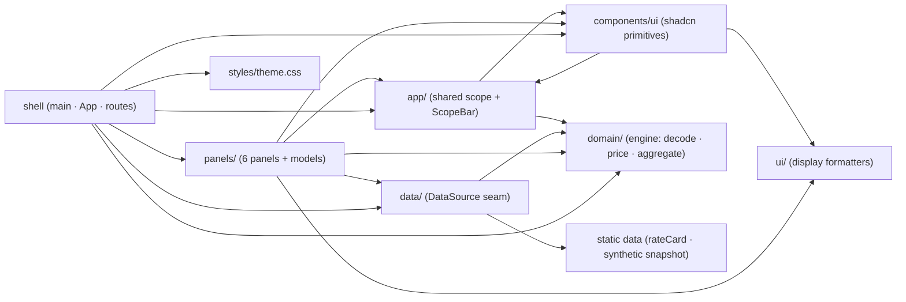

# Architecture

The module graph below is **generated from the real imports** (madge → Mermaid; GitHub renders it
natively). Regenerate after structural changes with `npm run arch:graph`.

<!-- arch:begin (generated — run `npm run arch:graph`) -->

<!-- arch:end -->

## Layers

| Layer           | Responsibility                                                                                                                                                  | Mutable?                            |
| --------------- | --------------------------------------------------------------------------------------------------------------------------------------------------------------- | ----------------------------------- |
| `domain/`       | The engine: ledger projection, ccusage tool decoders, exact BigInt pico-USD pricing (point-in-time rate bands), aggregations, buckets/intensity, shared scoping | Mostly **frozen** (verifier-pinned) |
| `data/`         | The DataSource seam — local ledger-projected snapshot with fixture fallback; the rate-card injection point the verifier drives                                  | realDataSource mutable              |
| `panels/`       | The six panels, each a thin view + a `select*` view-model over the engine                                                                                       | Mutable                             |
| `app/`          | The one shared `(range, source)` scope + ScopeBar; selections persist across navigation                                                                         | Mutable                             |
| `components/ui` | shadcn-style primitives (Card, StatTile, PanelShell, `cn`) on the validated dark theme                                                                          | Mutable                             |
| `ui/`           | Display-boundary formatters — money stays exact BigInt until the final render step                                                                              | Mutable                             |
| `shell`         | `main.tsx` entry (build-time snapshot load) + `App.tsx` routes/nav                                                                                              | Mutable                             |

Two invariants worth knowing when reading the graph:

- **Dependencies point downward** — panels consume `domain/` and `ui/`; nothing imports from `panels/`,
  and panels never import each other.
- **The verifier defines "correct."** `scripts/verify.mjs` + the frozen panel oracle recompute every
  rendered value independently; the frozen files (engine, goldens, harness) can only change with a
  human-gated baseline re-cut. See the README's verifier section.
